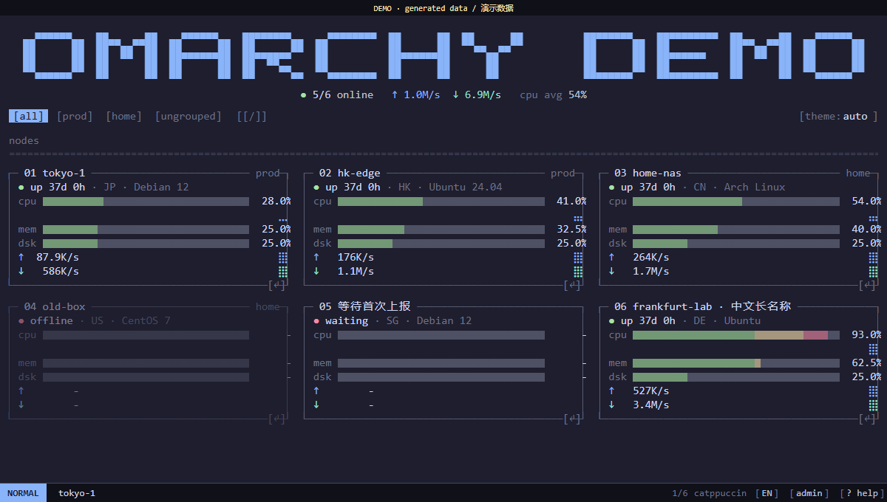
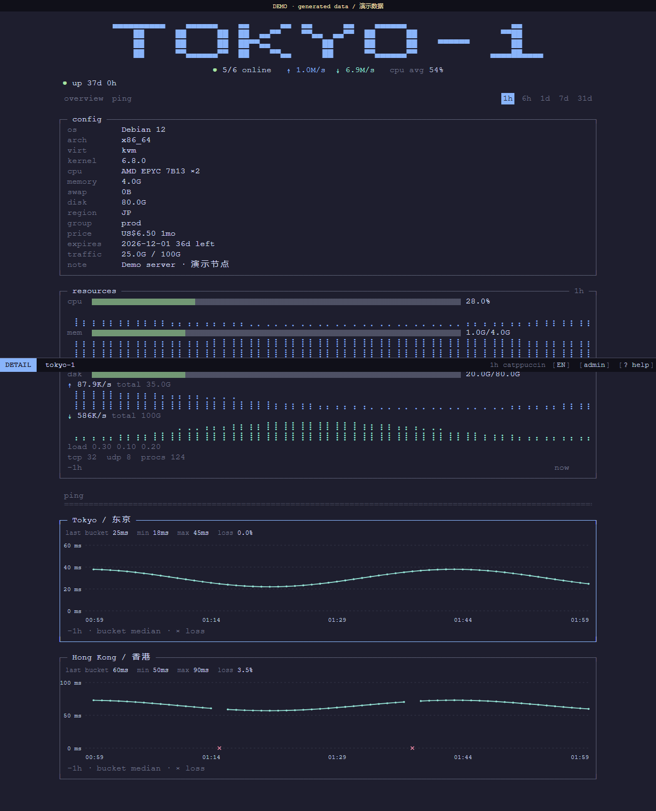
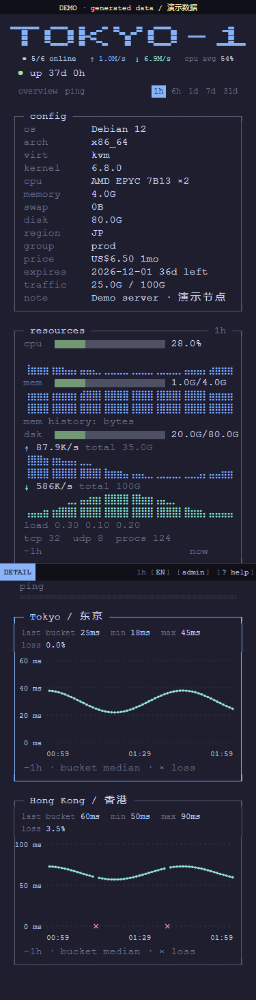

# Monitor Omarchy

为 [Monitor](https://github.com/monitor-probe/monitor) 移植的 **Omarchy 终端风格公开状态页主题**。

[](LICENSE)
[](https://github.com/ayingQAQ/monitor-theme-omarchy/releases/latest)

基于 [with5/komari-theme-omarchy](https://github.com/with5/komari-theme-omarchy)，尽量保留原版的 ASCII 横幅、字符边框、btop 仪表、字符历史图、23 套配色和 Vim 交互，重新接入 Monitor 数据协议。

Independent Omarchy-style theme port for Monitor. Not affiliated with or endorsed by Omarchy or its authors, Komari, or Monitor.

## 预览

截图均使用明确标记的开发演示数据，不包含真实服务器信息。



<details>
<summary>节点详情与手机布局</summary>





</details>

## 安装

在 Monitor 后台进入「主题」，选择「从 GitHub 安装」，填写：

```text
https://github.com/ayingQAQ/monitor-theme-omarchy
```

安装后选择 **Omarchy · Monitor**，通过后台的主题设置按钮调整默认外观。

也可以从 [最新正式 Release](https://github.com/ayingQAQ/monitor-theme-omarchy/releases/latest) 下载 **`theme.tar.gz`**，在 Monitor 后台上传安装。不要下载 GitHub 自动生成的 Source code ZIP/TAR。

Release 同时提供 `theme.tar.gz.sha256`，可在下载目录校验：

```powershell
# Windows PowerShell：将输出与校验文件中的值比较
Get-FileHash .\theme.tar.gz -Algorithm SHA256
Get-Content .\theme.tar.gz.sha256
```

```bash
# Linux
sha256sum -c theme.tar.gz.sha256
```

## 功能

- **终端视觉**：等宽排版、直角字符框、btop 风格资源条、CPU 与网速字符图。
- **ASCII 横幅**：英文和中文站点名；五种效果、随机播放、点击重播。
- **23 套配色**：默认使用 Catppuccin；站长可分别设置深浅色默认配色，访客可自行切换。
- **中英文界面**：访客选择优先，其次为站点默认和浏览器语言。
- **节点浏览**：分组、搜索、在线与网速汇总；汇总跟随当前筛选结果。
- **节点详情**：机器信息、实时资源、历史曲线、费用、账期、到期与流量。
- **延迟监控**：按探测任务显示延迟折线、时间/延迟刻度、丢包位置、窗口丢包率及单任务放大。
- **键盘操作**：Vim 风格导航，同时支持常规 Tab 焦点和原生按钮激活。
- **空闲屏保**：90 秒未操作后启用；遵循系统减少动态效果设置。
- **连接恢复**：文本/gzip WebSocket、顺序解码、断流重连和 REST 轮询兜底。
- **异常兼容**：区分离线、等待上报、异常指标、空数据和请求错误；浏览器禁用存储时仍可使用。

## 快捷键

| 按键 | 首页操作 |
| --- | --- |
| `h` `j` `k` `l` / 方向键 | 在节点间移动 |
| `gg` / `G` | 第一个 / 最后一个节点 |
| `0` / `$` | 当前行开头 / 末尾 |
| 数字前缀，例如 `3j`、`5G` | 重复移动 / 跳转指定节点 |
| `Enter` | 打开当前节点详情 |
| `/` 或搜索按钮 | 搜索节点名称与分组 |
| `H` / `L` | 上一个 / 下一个分组 |
| `u` / `Esc` | 清除搜索，再清除分组 |
| `t` / `T` | 下一套 / 上一套配色 |
| `i` | 切换中英文 |
| `r` / `s` | 重播横幅 / 启动屏保 |
| `a` / `?` | 打开后台 / 查看帮助 |

| 按键 | 详情操作 |
| --- | --- |
| `o` / `p` | 概览 / 延迟 |
| `h` `l` / `[` `]` / 左右方向键 | 切换历史时间范围 |
| `j` / `k` | 延迟页选任务；概览页滚动 |
| `Enter` | 放大当前探测任务 |
| `u` / `Esc` | 先退出放大，再返回列表 |
| `R` | 立即刷新历史 |
| `Tab` | 常规焦点导航 |

输入框、选择框、原生按钮激活和输入法组合输入不会被普通字符快捷键抢占。屏保中常规操作可退出屏保。

## 主题设置

| 设置 | 默认值 | 说明 |
| --- | --- | --- |
| 默认语言 | `auto` | 可选 `auto`、`en`、`zh` |
| 暗色配色 | `catppuccin` | 系统为暗色时采用 |
| 亮色配色 | `catppuccin` | 系统为亮色时采用 |
| 允许切换配色 | 开启 | 关闭后忽略访客已保存的配色 |
| 显示分组筛选 | 开启 | 隐藏控件不会删除节点 |
| 横幅文字 | 留空 | 默认使用站点名 |
| 开场动画 | `random` | 五种效果、随机或关闭 |
| 空闲屏保 | 开启 | 90 秒后启用，减少动效优先 |

站点设置声明在 `theme.json`，由 Hub 保存；访客语言和配色仅存于自己的浏览器。存储不可用时，当次会话仍能切换外观。

## 数据语义与移植差异

- **累计流量来自 Hub**，不在浏览器里累加瞬时网速。当前计费周期遵循节点的重置日和计算方式。
- 到期和离线时长优先使用 `expires_in`、`last_seen_ago`；仅在旧版缺少字段时估算。
- 历史时间范围跟随 `history_days`，不会展示超出保留期的固定按钮。
- 延迟曲线展示 **时间桶中位数**；窗口丢包率采用 Hub 结果，完整 `band` 才用于范围最小/最大值。
- 不展示无法从聚合数据准确还原的原始 p50/p95/p99、抖动、标准差和样本数。
- 内存历史使用字节单位，不用当前容量反算历史百分比。
- Monitor 标准接口没有 Komari unlock-test 的数据，已移除解锁页面及相关请求。
- 即使浏览器已登录管理员，本主题也不展示私有地址、hostname、私有备注或 token。

接口处理依据：[主题开发指南](https://monitor-document.pages.dev/dev/theme)、[架构与协议](https://monitor-document.pages.dev/dev/architecture)、[流量说明](https://monitor-document.pages.dev/config/traffic)。

## 来源与许可

采用 [MIT License](LICENSE)。原始主题作者为 **with5**，Monitor 移植与适配维护者为 **ayingQAQ**。

来源基线：[`with5/komari-theme-omarchy@e7f51d6`](https://github.com/with5/komari-theme-omarchy/tree/e7f51d6429ab236784445a4f06e0d5c285734b7a)。完整保留原作者版权声明；来源、改动及依赖许可见 [THIRD_PARTY.md](THIRD_PARTY.md) 和 [THIRD_PARTY_NOTICES.txt](THIRD_PARTY_NOTICES.txt)。
